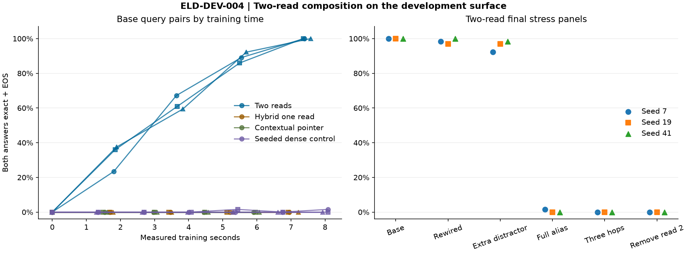

# ELD-DEV-004 results

The frozen local comparison used seeds 7, 19 and 41, in that order. The two-read, hybrid one-read and contextual-pointer arms ran from `6615886b1a37fd535682bdee38157e4c44cd0783`. The dense control uses its repaired deterministic initializer at `cc38d9850053941097f1d80a4c0b3bbd57f765e7`. The three original dense receipts are preserved and marked superseded for seeded comparison.

| Endpoint, pairs fully correct | Seed 7 | Seed 19 | Seed 41 |
| --- | ---: | ---: | ---: |
| Two reads, base at update 384 | **64/64** | **64/64** | **64/64** |
| Hybrid one read, base at update 384 | 0/64 | 0/64 | 0/64 |
| Contextual pointer, base at update 384 | 0/64 | 0/64 | 0/64 |
| Seeded dense, base at update 384 | 0/64 | 1/64 | 0/64 |
| Seeded dense, base at update 576 | 1/64 | 0/64 | 0/64 |
| Two reads, rewired terminal | **63/64** | **62/64** | **64/64** |
| Two reads, extra distractor | **59/64** | **62/64** | **63/64** |
| Two reads, unseen symbols and separator | 1/64 | 0/64 | 0/64 |
| Two reads, three-hop graph | 0/64 | 0/64 | 0/64 |
| Two reads, second read disabled | 0/64 | 0/64 | 0/64 |

Base exact+EOS for the candidate was 128/128 per seed. All neutralized-query pairs failed as expected. Primary formation and equal-update superiority passed. The preregistered mechanism screen required both rewiring and alias robustness. **The alias gate failed**, so there is no qualified cross-render promotion. The deterministic graph solver achieved 64/64 base pairs. A one-edge oracle solved 0/128 answers, and the position and frequency controls scored 0/64 pairs.

The read-only follow-up separates unseen symbols from punctuation. Symbol-only results were 64/64, 12/64 and 0/64. Separator-only results were 2/64, 45/64 and 59/64. Both factors matter, with seed-dependent sensitivity. First-read argmax matched the actual middle symbol on 128/128, 127/128 and 127/128 queries. At the answer position, a diagnostic intervention forced the other chain's middle symbol into the first copy distribution. The decoder then emitted the other chain's terminal with valid EOS on 128/128 queries per seed. This tests mediation within the trained candidate. The normal inference path receives no such intervention or intermediate labels.

The 64 pair views share 16 root-pair clusters and a single generator. The findings establish composition on the tested two-edge graph family and its matched rewiring intervention. The three-hop and alias failures bound that result. The 384-update comparison matches exposures. Training-time matching is a separate check, documented in [architecture comparison](ARCHITECTURE_COMPARISON.md).

## Work and custody

The fifteen completed original and repaired comparison arms used 6,912 updates, 2,875,392 training tokens, about 196.09 s in process and 192.86 CPU seconds. The supplemental two-step expanded CPU canary and two historical replay runs are separate. The first twelve runs were monitored as a process tree. Peak sampled aggregate RSS was 297.96 MiB and the lowest sampled available physical memory was 6.40 GiB. GPU-device-hours were zero. Inference made 51,811 model calls, emitted 51,811 tokens and evaluated 1,354,477 prefix positions.

The [custody manifest](../../artifacts/elendril/eld-dev-004/manifest.json) binds the full receipt files, figure and 84 checkpoint inventories across ELD-DEV-004, its supplemental runs, and the ELD-DEV-003 replay. The separate-process two-read restart matched all six state component hashes, update telemetry and predictions. Checkpoint payloads remain in the local sibling run folders. The [diagnostic operator](../../tools/elendril_join_diagnostic.py) runs from the pinned source with the original checkpoint root, a new output path and the pinned checkout on PYTHONPATH.

Run a single arm from its source checkout with `python -m anra_v5.elendril pilot --surface join-v1 --method two-read --arm binding --seed 7 --steps 384 --root <fresh-root> --output <fresh.json>`. For repaired dense use its recorded source, `--method capacity-matched` and `--steps 576`. Independently replay metrics with `python -m anra_v5.elendril rescore --receipt <fresh.json>`.
