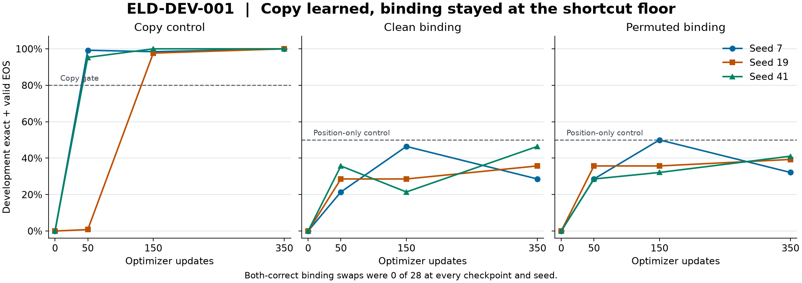

# ELD-DEV-001 observations

All nine registered arms completed at source `cc8e50a5bafa9bf1adfd278b9ee88139973caa98` with fresh model weights. Environment was Windows AMD64 AVX2 on Ryzen 7 170, Python 3.11.15 and PyTorch 2.14.0+cpu, CPU FP32, deterministic algorithms and one intra-op thread. Hardware admission found approximately 3.4 GiB free system RAM immediately before the batch. Runs were serial. Peak resident memory was unmeasured. No GPU or paid compute was used.

| Arm | Seed | Update 0 exact | Update 50 exact | Update 150 exact | Update 350 exact | Final both-correct swaps |
| --- | ---: | ---: | ---: | ---: | ---: | ---: |
| Copy | 7 | 0/128 | 127/128 | 126/128 | 128/128 | — |
| Copy | 19 | 0/128 | 1/128 | 125/128 | 128/128 | — |
| Copy | 41 | 0/128 | 122/128 | 128/128 | 128/128 | — |
| Binding | 7 | 0/56 | 12/56 | 26/56 | 16/56 | 0/28 |
| Binding | 19 | 0/56 | 16/56 | 16/56 | 20/56 | 0/28 |
| Binding | 41 | 0/56 | 20/56 | 12/56 | 26/56 | 0/28 |
| Binding-permuted | 7 | 0/56 | 16/56 | 28/56 | 18/56 | 0/28 |
| Binding-permuted | 19 | 0/56 | 20/56 | 20/56 | 22/56 | 0/28 |
| Binding-permuted | 41 | 0/56 | 16/56 | 18/56 | 23/56 | 0/28 |

Copy passed its frozen gate. The parser control also reached 128/128. Clean binding fell below the measured 28/56 positional benchmark at every endpoint. Final clean-minus-permuted exact differences were −2/56, −2/56 and +3/56. Both-correct stayed zero across all checkpoints and arms. All endpoints reached valid EOS for every development row. The three seeds used the same seven development worlds. Reported ranges are descriptive and the analysis does not treat the views as independent.

The post-pilot read-only diagnostic restored six binding checkpoints. Every arm attained exactly 84/168 on its actual training labels, 0/84 both-correct and 0/21 all views correct. Scoring the corrupted models against clean training labels also yielded 84/168. This supports an acquisition failure under the tested procedure. The current evidence leaves the cause of the acquisition failure unresolved. The diagnostic ran for 9.64 seconds and made zero updates.

The registered batch made 3,150 updates over 638,400 non-BOS nonpadding training tokens, including 134,400 supervised answer/EOS targets. Inference emitted 9,550 tokens, made 9,550 forwards and evaluated 97,739 input positions. In-process wall time summed to 119.66 s, of which free generation took 33.23 s. Measured process CPU time summed to 114.09 s. These timers exclude shell startup, dependency imports, independent rescoring and the restart and diagnostic checks.

All nine receipts were independently rescored in fresh processes, 36 snapshots total. The [custody manifest](../../artifacts/elendril/eld-dev-001/manifest.json) binds the raw prediction token IDs, step telemetry, seeds, train/dev hashes, configuration and checkpoint inventories. The [restart receipt](../../artifacts/elendril/eld-dev-001/restart-verification.json) records the separate 8-update, 3+5 continuation experiment.

